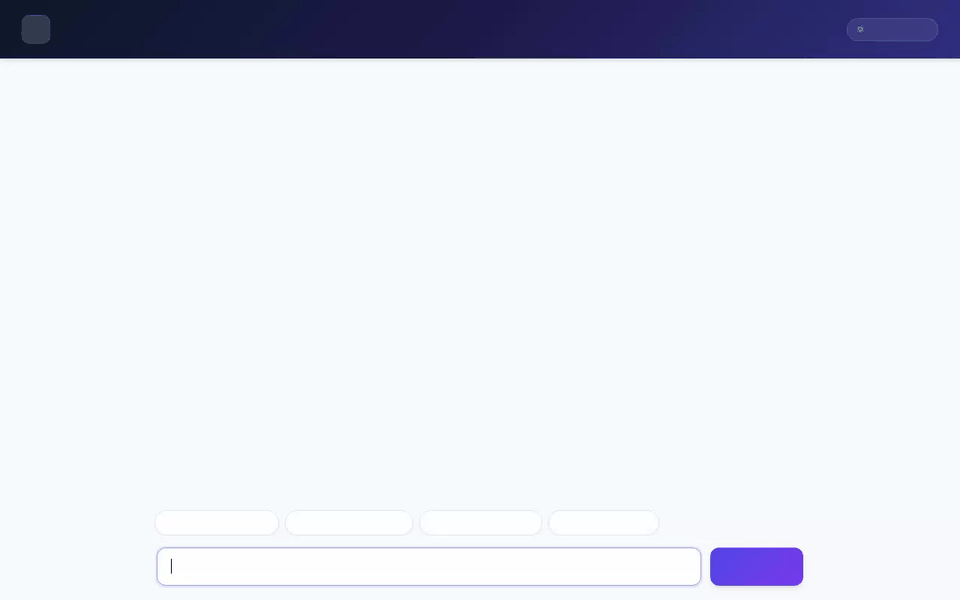

# UrbanNest Concierge 🏡🤖

UrbanNest Concierge is an intelligent AI real estate assistant built with Google's **Agent Development Kit (ADK)** and deployed on **Google Cloud Agent Platform**. It helps home seekers discover rental properties, evaluate affordability, inspect neighborhood amenities, and generate AI architectural visualizations.



---

## 🌟 Implemented Features & Architecture

### **1. Real Estate & Database Capabilities (Cloud Firestore)**
- **Property Listing Search (`search_listings`):** Searches available apartments in Firestore with optional citywide or neighborhood filtering, price caps, and bedroom counts.
- **Listing Details (`get_listing_details`):** Retrieves complete specs, pricing, and landlord contact details from Firestore.
- **Favorites Management (`save_favorite`):** Saves user property favorites into the Firestore `favorites` collection.
- **Amenity Management (`update_listing_amenities`):** Updates amenity tags for listings.

### **2. Financial & Geographic Intelligence**
- **Affordability Calculator (`calculate_affordability`):** Evaluates gross income against proposed rent and debt obligations using the 30% rent and 43% total debt rule.
- **Nearby Amenities Search (`get_nearby_amenities`):** Retrieves categorized local facilities (hospitals, schools, colleges, malls, bus stops, railway stations).
- **Google Maps Geocoding (`geocode_address`):** Converts physical addresses into exact latitude and longitude coordinates.
- **Google Places API (`find_nearby_places`):** Searches nearby points of interest (restaurants, parks, hospitals) within a given radius using Google Places API (New).
- **ZIP Code Lookup (`lookup_zipcode_info`):** Resolves US postal ZIP codes to city, state, and coordinates.

### **3. AI Image Generation & Cloud Assets (Vertex AI & Cloud Storage)**
- **Architectural Rendering (`generate_property_image`):** Uses Imagen (`gemini-3.1-flash-lite-image`) on Vertex AI to generate photorealistic interior/exterior renders.
- **GCS Asset Bucket:** Automatically uploads generated image renderings to a public Google Cloud Storage bucket (`gs://urbannest-concierge-assets-...`) and provides public HTTPS image URLs.

### **4. Cross-Session Long-Term Memory (Vertex AI Memory Bank)**
- **User Preference Retention:** Uses `PreloadMemoryTool` and `VertexAiMemoryBankService` to automatically retain user budget limits, healthcare proximity needs, and lifestyle preferences across separate chat sessions.

### **5. Rich Display Interface (A2UI & Custom Proxy)**
- **A2UI v0.8 Integration:** Uses `A2uiSchemaManager` and `BasicCatalog` (`a2ui_callback`) to render rich interactive display cards, image carousels, and tables directly inside the chat window.
- **Branded Web Frontend:** Modern FastAPI proxy translating Agent-to-Agent (A2A) protocol events into structured UI components with prompt suggestions and custom styling.

---

## 🛠️ Project Structure

```text
urbannest-concierge/
├── app/
│   ├── agent.py            # Core ADK agent, tool definitions, and callbacks
│   ├── a2ui_utils.py       # A2UI v0.8 schema manager and model callbacks
│   └── __init__.py
├── frontend/
│   ├── main.py             # FastAPI A2A proxy server
│   ├── static/index.html   # Branded web chat interface with A2UI renderer
│   ├── Dockerfile          # Cloud Run container definition
│   └── requirements.txt
├── videos/
│   ├── demo.gif            # Looping demonstration recording
│   └── demo_video.webm     # Original recording
├── agents-cli-manifest.yaml# Manifest for Agent Engine deployment
├── deployment_metadata.json# Deployed Reasoning Engine resource metadata
└── pyproject.toml          # Python project dependencies
```

---

## 🚀 Setup & Local Execution

### **Prerequisites**
- Python 3.10+ and `uv` package manager
- Google Cloud SDK (`gcloud`) authenticated to your GCP project
- Firestore database enabled
- Environment variable `GOOGLE_MAPS_API_KEY` set

### **1. Install Dependencies**
```bash
uv sync
```

### **2. Set Environment Variables**
Create or update `.env` in the root directory:
```bash
GOOGLE_MAPS_API_KEY="<YOUR_API_KEY>"
```

### **3. Run the Playground Locally**
Start the ADK Web playground with local Memory Bank service connection:
```bash
uv run adk web . --port 8080 --reload_agents
```

### **4. Run the Branded Chat Web Frontend Locally**
Navigate to the `frontend/` directory and start the FastAPI proxy:
```bash
cd frontend
export AGENT_DIRECTORY="app"
export AGENT_ENGINE_RESOURCE_NAME="projects/<PROJECT_ID>/locations/<LOCATION>/reasoningEngines/<ENGINE_ID>"
uv run python main.py
```
Open your browser to port `8080` to access the chat application.

---

## ☁️ Deployment

### **Deploy Agent to Agent Platform**
Deploy the agent backend to Vertex AI Reasoning Engine:
```bash
agents-cli deploy --update-env-vars GOOGLE_MAPS_API_KEY=$GOOGLE_MAPS_API_KEY
```

### **Deploy Frontend to Cloud Run**
Deploy the web proxy to Cloud Run:
```bash
cd frontend
gcloud run deploy urbannest-concierge-frontend \
  --source . \
  --region us-east1 \
  --allow-unauthenticated \
  --set-env-vars AGENT_ENGINE_RESOURCE_NAME="<ENGINE_RESOURCE_NAME>",AGENT_DIRECTORY="app"
```
Ensure your Cloud Run service account has `roles/aiplatform.user` granted.
